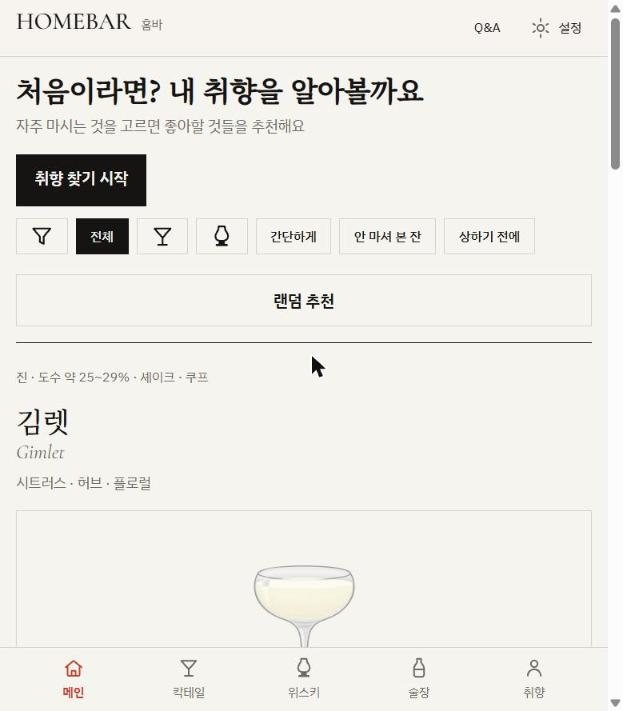
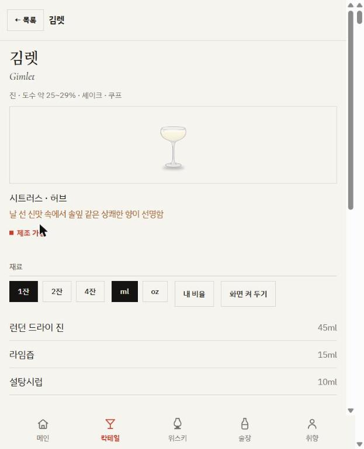
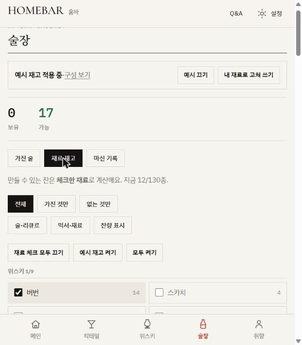

# 홈바 플랫폼

[](https://github.com/squarekim/homebar/actions/workflows/deploy-pages.yml)


보유한 재료로 만들 수 있는 칵테일을 찾아주는 모바일 우선 웹앱입니다.
재료를 체크하면 칵테일 202종의 제조 가능 여부를 계산합니다.
재료를 하나 더 샀을 때 만들 수 있는 레시피, 취향에 맞는 술, 위스키 컬렉션에 부족한 종류도 확인할 수 있습니다.

별도 서버나 계정, 설치 없이 브라우저에서 사용합니다. 입력한 값은 사용자 브라우저에만 저장합니다.

[홈바 플랫폼 베타 사용하기](https://squarekim.github.io/homebar/)

> [!NOTE]
> 아직 정식 공개 전입니다. 현재 `beta` 빌드에는 오너의 홈바 데이터인 보유 주류 82종과 재고 69건이 들어 있습니다.
> 직접 수정하며 사용해 보셔도 됩니다. 변경한 값은 각자 브라우저에만 저장되며 원본에 영향을 주지 않습니다.
> 개인 데이터를 뺀 정식 공개판은 [배포 프로필](#배포-프로필)을 바꿔 배포합니다.

<p align="center">
  
  
  
</p>

## 목차

- [주요 기능](#주요-기능)
- [시작하기](#시작하기)
- [사용법](#사용법)
- [동작 방식](#동작-방식)
- [담긴 데이터](#담긴-데이터)
- [개발](#개발)
- [배포](#배포)
- [프로젝트 구조](#프로젝트-구조)
- [로드맵](#로드맵)
- [기여](#기여)
- [라이선스](#라이선스)
- [만든 배경과 출처](#만든-배경과-출처)

## 주요 기능

- 재료 128종의 보유 여부를 체크하면 레시피 202종의 제조 가능 여부를 바로 다시 계산합니다.
- 주류 기준 DB 377종에서 제품을 검색해 등록합니다. 대분류·세부분류·도수·용량·원산지·위스키 분류·칵테일 표준 재료를 자동으로 채웁니다.
- 셰이커 없이 잔에 바로 붓는 간단 조합 70종을 제공합니다. 비율과 잔, 보유한 술로 만드는 방법을 안내합니다.
- 변형 레시피 42종을 원형과 연결합니다. 올드 패션드에서 몬테 카를로·팬시 프리를 찾아가거나, 변형 레시피에서 "설탕 대신 베네딕틴"처럼 바뀐 재료를 확인할 수 있습니다.
- 구매 시뮬레이션은 재료 하나를 샀을 때 추가로 만들 수 있는 레시피 수를 기준으로 순위를 매깁니다.
- 취향 추천은 14축 향미 벡터로 계산하며 점수와 이유를 함께 보여줍니다. 외부 AI는 사용하지 않습니다.
- 그룹 추천은 여러 사람의 취향을 결합합니다. 한 명이라도 강하게 싫어하는 향미에는 감점을 적용합니다.
- 위스키 컬렉션을 지역 × 숙성 매트릭스와 축별 커버리지로 분석합니다. 부족한 종류를 확인하고 구매 시뮬레이터로 추가할 병을 비교할 수 있습니다.
- 음용 기록, JSON 백업, PWA 설치와 오프라인 사용을 지원합니다.

## 시작하기

### 그냥 써보기

[베타 사이트](https://squarekim.github.io/homebar/)를 열면 설치나 가입 없이 사용할 수 있습니다.
모바일 브라우저에서 `홈 화면에 추가`를 누르면 PWA로 설치할 수 있습니다.

> [!IMPORTANT]
> 카카오톡·인스타그램 등 앱 내장 브라우저나 시크릿 모드에서는 브라우저 저장소가 막혀 있어 동작하지 않습니다.
> 저장소 접근 안내 화면이 뜨면 사파리·크롬의 일반 모드로 다시 열어 주세요.

### 로컬에서 실행

```bash
git clone https://github.com/squarekim/homebar.git
cd homebar/app
npm install
npm run dev      # http://localhost:5173
```

Node.js 20 이상이 필요합니다. 별도 서버나 DB 구축, API 키는 필요하지 않습니다.

## 사용법

### 5분 시작

1. `내 술장 → 재료 재고`에서 `보유재료 초기화`를 누르고 집에 있는 재료를 체크하세요. 체크할 때마다 상단의 제조 가능 레시피 수가 바뀝니다.
2. `내 술장 → 술 추가`에서 보유한 술을 등록하세요. `발베니 12`, `조니블랙`, `Absolut`처럼 제품명이나 별칭으로 검색할 수 있습니다.
3. 레시피 상세의 `이 잔 기록하기` 또는 `기록` 탭에서 마신 술을 기록하세요. 기록이 쌓이면 취향 프로필을 자동으로 만듭니다.

`내 술장` 상단의 숫자 4개, 정규·근사·불가·보유재료를 누르면 각 항목의 뜻을 볼 수 있습니다.

### 상황별로 어디를 여나

| 하고 싶은 일 | 메뉴 | 확인할 내용 |
|---|---|---|
| 오늘 마실 술 고르기 | 오늘 | 기분별 추천, 보유 재료로 만들 수 있는 술 필터 |
| 칵테일 제조 가능 여부 확인 | 칵테일 | 레시피별 판정과 부족한 재료 |
| 간단하게 한 잔 만들기 | 칵테일 → 간단 조합 | 하이볼·토닉류 70종의 비율, 잔, 사용할 수 있는 보유 술 |
| 살 재료 고르기 | 오늘 → 뭘 사면 좋을까 | 재료 하나를 샀을 때 추가로 만들 수 있는 레시피 수 |
| 친구와 마실 술 고르기 | 오늘 → 함께 마실 사람 | 여러 사람의 취향을 결합한 추천 |
| 새로 산 술 등록하기 | 내 술장 → 술 추가 | 제품명으로 검색해 분류·도수·표준 재료 자동 입력 |
| 보유한 술 확인하기 | 내 술장 → 보유 술 | 보유 병 전체, 분류·뱃지·공식 노트·연결된 표준 재료 |
| 살 위스키 고르기 | 위스키 → 축별 커버리지 | 컬렉션에 부족한 종류와 구매 시뮬레이터 |

### 탭 구성

| 탭 | 내용 |
|---|---|
| 오늘 | 기분별 추천 · 함께 마실 사람 · 뭘 사면 좋을까 · 재고 소진 · 최근 기록 |
| 칵테일 | 레시피 목록(기주·IBA·제조 가능 필터) · 간단 조합 · 재료 목록 |
| 위스키 | 컬렉션(분류·공식 노트) · 지역 × 숙성 매트릭스 · 축별 커버리지 · 구매 시뮬레이터 |
| 내 술장 | 보유 술 · 재료 재고 · 판정 통계 · 술 추가 |
| 기록 | 음용 기록 |
| 설정(헤더) | 좋아하는 맛(취향 14축) · 함께 마시는 사람 · 백업·복원 · 버전 |

## 동작 방식

### 판정 4단계

| 상태 | 뜻 |
|---|---|
| 정규 | 필수 재료를 모두 보유해 원 레시피대로 만들 수 있습니다. |
| 근사 | 일부 재료를 대체재로 충당해 만들 수 있습니다. |
| 일부부족 | 기주는 있지만 부재료가 부족합니다. |
| 불가 | 기주 등 핵심 재료가 없습니다. |

`(선택)`으로 표기한 재료는 판정에서 제외합니다. 구조화된 재고 데이터로만 계산하며, 레시피 설명문은 판정에 사용하지 않습니다.

### 표준 재료로 레시피 매칭

```
봄베이 사파이어 ┐
탱커레이       ├→ 표준 재료 '런던 드라이 진' → 진토닉 · 네그로니 · 마티니 …
비피터         ┘
```

같은 표준 재료에 속하는 제품은 브랜드가 달라도 만들 수 있는 레시피가 같습니다.
술을 추가하면 해당 표준 재료에 자동으로 연결합니다.

### 취향 14축

단맛 · 스모크 · 피트 · 과일 · 바닐라 · 카라멜 · 오크 · 스파이스 · 플로럴 · 허브 · 시트러스 · 견과 · 초콜릿 · 바디를 각각 0~10으로 표현합니다.
추천 엔진은 외부 AI 없이 이 향미 벡터로 계산합니다.

### 내 데이터는 어디에 있나

- 재고·기록·취향·메모·추가한 술은 브라우저의 IndexedDB에만 저장합니다. 서버로 전송하지 않습니다.
- 기기를 옮기려면 `설정 → 백업 · 복원`에서 백업 파일을 받고 새 기기에서 복원하세요.
- 브라우저 데이터를 지우면 저장한 내용도 함께 지워집니다. 중요한 기록은 주기적으로 백업하세요.
- 같은 링크를 여러 명이 열어도 각자의 데이터는 서로 영향을 주지 않습니다.

## 담긴 데이터

| 데이터 | 수량 | 비고 |
|---|---|---|
| 칵테일 레시피 | 202종 | 현행 IBA 99종 포함. 재료 참조 732건을 모두 재료 마스터에 매핑 |
| 재료 마스터 | 128종 | 재고·레시피가 공유하는 표준 재료 |
| 간단 조합 | 70종 | 믹서 비율표와 Build 계열 레시피 |
| 주류 기준 DB | 377종 | 위스키 145 · 리큐르 54 · 맥주 37(수제맥주 16 포함) · 사케·소주·전통주 27 · 진 16 · 럼 16 · 보드카 13 · 데킬라 13 · 브랜디 13 · RTD·캔칵테일 10 · 부재료 10 · 베르무트 9 · 와인 9 · 기타 5 |
| 제조사 공식 노트 | 42종 | 제품 ID 기준. 공식 사이트 등 출처 URL과 함께 표기하며, 확인하지 못한 제품은 비워 둠 |
| 오너 컬렉션(beta) | 82종 | 위스키 23종 포함. 정식 공개판에서는 제외 |

## 개발

```bash
cd app
npm run dev           # 개발 서버 (beta 프로필)
npm run build         # 타입체크 후 빌드(dist/), 오너 데이터 포함
npm run build:public  # 공개 배포 빌드(dist-public/), 개인 데이터 제외
npm test              # 단위 테스트(vitest) 70건
```

React 18, TypeScript, Vite, Dexie(IndexedDB)를 사용하며 PWA를 지원합니다. 런타임 의존성은 4개입니다.
향후 Capacitor로 Android APK를 만들 수 있도록 브라우저 전용 코드는 저장소 계층 뒤에 격리했습니다.

기여 규칙과 아키텍처, 데이터 수정 시 주의사항은 [CONTRIBUTING.md](CONTRIBUTING.md)에 있습니다.

## 배포

`.github/workflows/deploy-pages.yml`로 GitHub Pages에 배포합니다. 워크플로는 수동으로만 실행합니다.

GitHub의 `Actions`에서 `Deploy to GitHub Pages`를 열고 `Run workflow`를 눌러 프로필을 선택하세요.

### 배포 프로필

| 항목 | `beta` (기본) | `public` |
|---|---|---|
| 레시피 202 · 재료 128 · 간단 조합 · 주류 마스터 377 | 포함 | 포함 |
| 오너 보유 주류 82종 · 개인 재고 69건 | 포함 | 번들에서 제외 |
| 첫 화면 | 오너 컬렉션 (정규 121) | 기본 홈바 세트 41종 (정규 79) |

`public` 빌드에서는 `app/scripts/makePublicSeed.mjs`가 개인 데이터를 제거한 시드를 만듭니다.
Vite 플러그인이 이 시드를 원본 대신 사용하며, 원본 `seed.ts`는 수정하지 않습니다.

배포 버전은 `설정 → 버전`의 빌드 시각과 커밋으로 확인할 수 있습니다.

## 프로젝트 구조

```
.
├── app/                    # 웹앱 (React + TypeScript + Vite)
│   ├── src/
│   │   ├── data/           # 시드(읽기 전용) + 파생: 향미·분류·용어·주류 마스터
│   │   ├── models/         # 도메인 타입
│   │   ├── db/             # Dexie 스키마·마이그레이션
│   │   ├── repositories/   # DB 접근 격리 계층
│   │   ├── services/       # 판정·추천·그룹·구매·검색·백업 (순수 로직)
│   │   └── ui/             # 화면 (하단 5탭 + 설정)
│   └── scripts/            # 시드 변환 스크립트 (손으로 고치지 않는다)
├── docs/screenshots/       # README 이미지
└── .github/workflows/      # Pages 배포
```

데이터는 `data → models → db → repositories → services → ui` 순서로 흐릅니다.
화면은 DB를 직접 호출하지 않습니다. 향후 계정·동기화를 추가할 때 저장소 계층을 교체할 수 있도록 구성했습니다.

## 로드맵

- [ ] 주류 기준 DB 확장 (현재 377종)
- [ ] 추가한 술 편집
- [x] 제조사 공식 노트를 기준 DB 제품에 매핑. 술 추가 화면에서 확인 가능
- [ ] 재고 잔량 입력 UI 개선
- [ ] 계정 · 기기 간 동기화
- [ ] Capacitor로 Android APK

## 기여

[CONTRIBUTING.md](CONTRIBUTING.md)에서 10분 세팅, 계층 규칙, `seed.ts`를 손으로 고치지 않는 이유와 PR 체크리스트를 확인해 주세요.

버그 제보와 기능 제안은 [이슈 템플릿](https://github.com/squarekim/homebar/issues/new/choose)을 이용해 주세요.

## 라이선스

라이선스는 아직 정하지 않았습니다. 라이선스가 명시되기 전까지는 저작권이 저작자에게 유보되며, 포크·재배포·상업적 이용은 허용되지 않습니다.
사용하고 싶다면 이슈로 문의해 주세요.

## 만든 배경과 출처

개인 홈바를 정리하던 엑셀 파일 `홈바_마스터_가이드_V54.xlsx`에서 출발했습니다.
그 데이터를 재사용하는 웹앱으로 확장하고 있습니다.

- 레시피 스펙은 [IBA(International Bartenders Association)](https://iba-world.com/) 공식 등재 항목을 우선했습니다. 비IBA 항목은 클래식·커뮤니티 표준을 출처와 함께 표기했습니다.
- 제조사 테이스팅 노트는 공식 브랜드·증류소 페이지에서 수집하고 출처 URL을 함께 저장했습니다. 확인되지 않은 항목은 비워 두었습니다.
- 위스키 분류는 원산지·타입·지역·캐스크·캐릭터를 라벨과 증류소 공개 정보에 따라 정리했습니다. 향미 벡터는 규칙으로 계산한 파생값이며 공식 데이터가 아닙니다.

### 원본에서 고친 것 (V54)

1. 블랙 러시안의 `커피 리큐르 [없음]` 표기를 수정했습니다. 보유 중인 깔루아가 커피 리큐르에 해당하므로 미보유 표기가 잘못됐습니다. 이 수정으로 정규 레시피 수가 104에서 105로 늘었습니다.
2. 플랜터즈 펀치의 `사탕수수 주스/시럽`을 `사탕수수 주스 또는 시럽`이라는 단일 재료로 통합했습니다. 슬래시를 구분자로 해석해 한 재료가 둘로 나뉘던 문제를 고쳤습니다.
